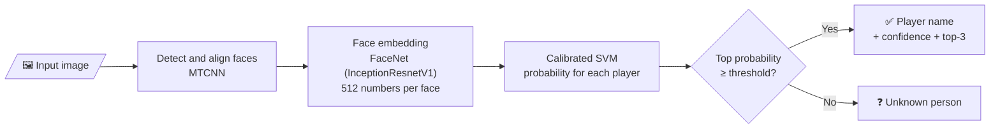
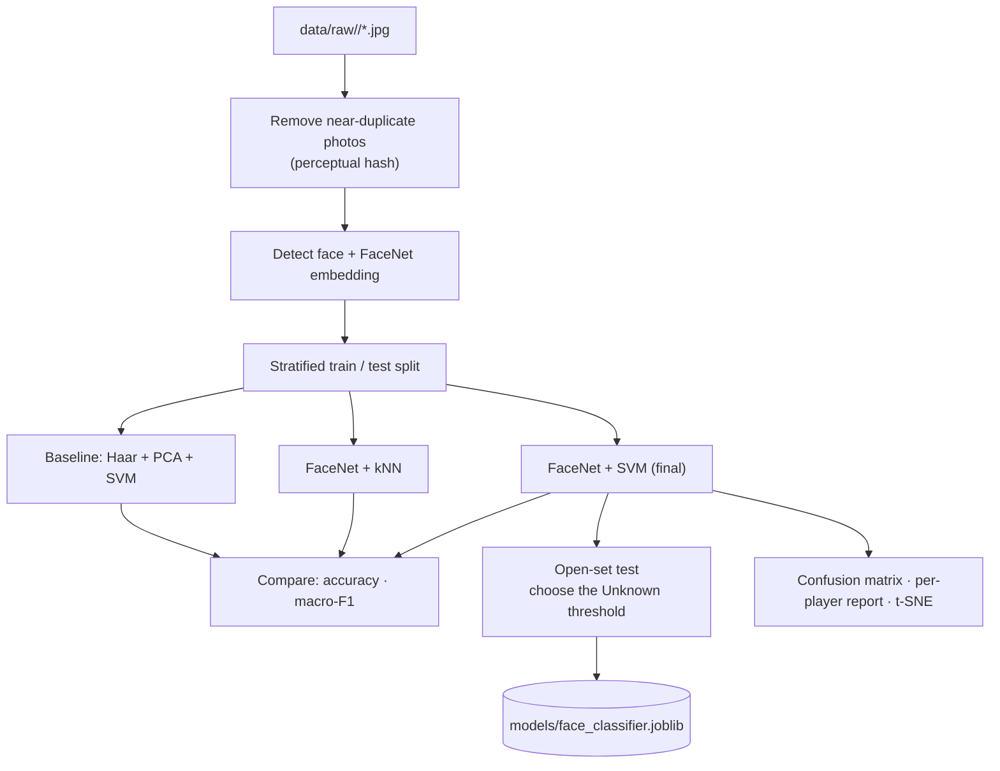
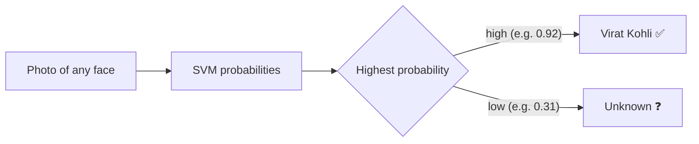
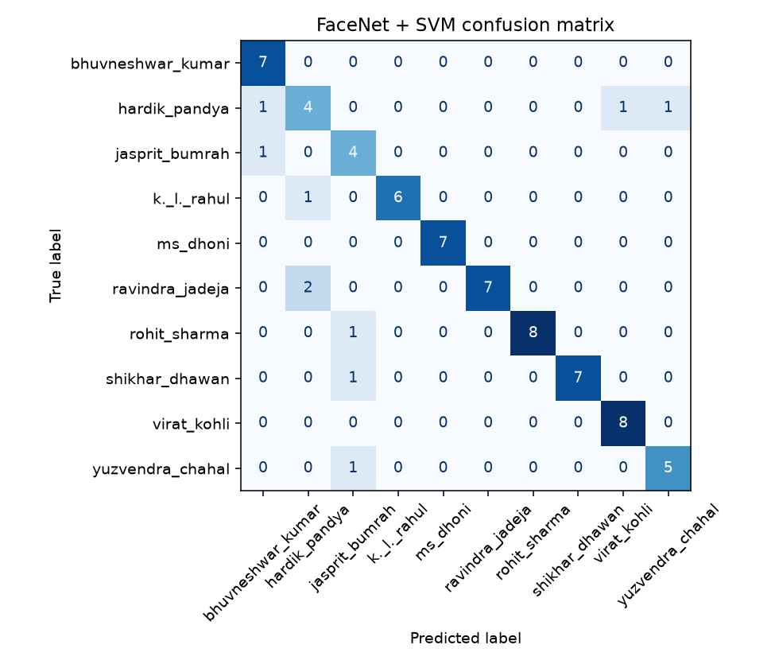
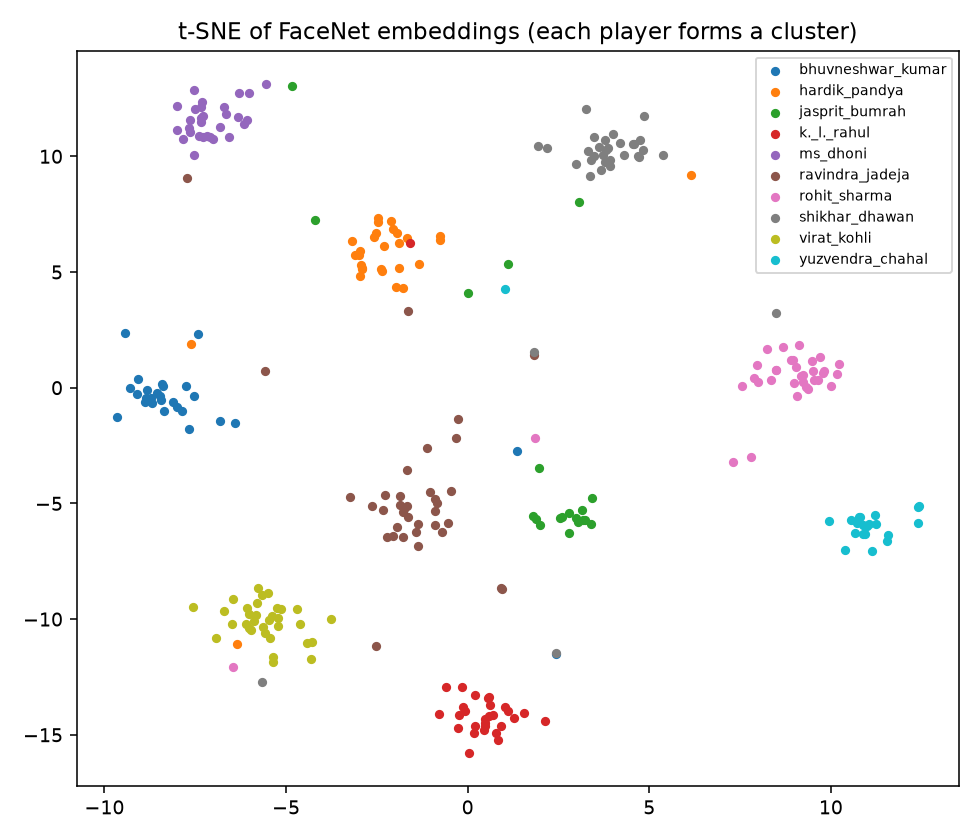

# 🏏 Indian Cricket Team Member Face Identification

> A computer vision system that **detects a face in an image and identifies which Indian cricket team member it is**, using pretrained **FaceNet embeddings** and a **calibrated SVM classifier**. If the face does not belong to any trained player, it says **"Unknown"** instead of guessing a wrong name.

[](https://colab.research.google.com/github/YOUR_GITHUB_USERNAME/indian-cricketer-face-identification/blob/main/notebooks/colab_runner.ipynb)


---

## 🎯 Problem statement

Develop a machine learning / computer vision system that can **identify a person from an image based on their facial features**. The system is trained using images of **selected Indian cricket team members** and must **classify a new input image into the corresponding person's name**.

This project builds that system end to end: it detects faces, converts each face into a numeric "fingerprint" (an embedding), and matches it against the players it was trained on.

---

## ✅ How the project meets each requirement

| Requirement from the problem statement | How it is done | Where |
|---|---|---|
| Identify a person from an image using facial features | Face detection (MTCNN) + face embeddings (FaceNet) | `src/embeddings.py` |
| Train using images of selected Indian cricket team members | One folder per player, near-duplicates removed, SVM trained on embeddings | `src/train.py`, `src/dedupe.py` |
| Classify a new image into the person's name | Top prediction with confidence, plus top-3 | `src/predict.py` |
| Show it works | Baseline vs final model, accuracy, macro-F1, confusion matrix, t-SNE plot | `src/train.py`, `results/` |
| Handle people who are not in the training set | **"Unknown" rejection** using a tuned confidence threshold | `src/classifier.py` |
| Easy to demo | Streamlit app: upload a photo, see the face box and top-3 names | `app.py` |

---

## ⚙️ How it works



**Step by step**

1. **Detect and align:** MTCNN finds every face in the image and crops it to a standard 160×160 size. Several faces in one photo are handled separately.
2. **Embed:** a **FaceNet** model (InceptionResnetV1, pretrained on VGGFace2) turns each face into a **512-number vector**. Photos of the same person land close together in this space, and photos of different people land far apart.
3. **Classify:** a **calibrated linear SVM**, trained on the player embeddings, gives a probability for each player.
4. **Accept or reject:** if the highest probability is below a tuned threshold, the face is labelled **Unknown**.

### Why embeddings instead of training a CNN from scratch?
With only about 60–100 photos per player, a CNN trained from scratch would **overfit** (memorise the training photos). FaceNet has already learned what makes faces different from millions of faces, so we only need a light classifier on top, and that needs very little data.

---

## 🏋️ Training pipeline



**Why remove near-duplicates first?** Datasets of public figures often contain the same photo several times (resized or cropped). If one copy lands in training and another in testing, the model looks better than it is. Duplicates are removed **before** splitting, so the test is fair.

---

## ❓ Unknown person rejection (open-set recognition)

A normal classifier must always pick one of the trained names, so a stranger would be labelled as a random player. This project avoids that.



**How the threshold is chosen (no extra data needed):** in turn, each player is hidden from training and treated as a **stranger**. The model is trained on the others and tested on two things:
- unseen photos of the **known** players (should be accepted and named correctly), and
- photos of the **hidden player** (should be rejected as Unknown).

Several thresholds are tried, and the one with the best balance between the two is saved with the model. You can also move the threshold with a slider in the demo app.

---

## 🗃️ Dataset and settings

**Dataset:** publicly available photos of 10 Indian cricket team members (public figures). The images are **not included** in this repository; place your own under `data/raw/<Player_Name>/`. Check the licence of any images you use.

| Player | Images kept | Near-duplicates removed |
|---|---|---|
| bhuvneshwar_kumar | 29 | 8 |
| hardik_pandya | 29 | 11 |
| jasprit_bumrah | 21 | 0 |
| k._l._rahul | 29 | 7 |
| ms_dhoni | 31 | 15 |
| ravindra_jadeja | 37 | 12 |
| rohit_sharma | 35 | 15 |
| shikhar_dhawan | 33 | 7 |
| virat_kohli | 34 | 14 |
| yuzvendra_chahal | 22 | 7 |
| **Total** | **300** | **96** |

- 396 images were collected; **96 (24%) were near-duplicates** and were removed before the split.
- Of the 300 kept images, **292 had a face detected** with enough confidence (8 were skipped).
- The 292 faces were split **75% / 25% (stratified): 219 for training, 73 for testing**, so every player appears in both parts.

| Setting | Value |
|---|---|
| Face detector | MTCNN (confidence ≥ 0.90, 160×160 aligned crop) |
| Embedding model | FaceNet InceptionResnetV1, pretrained on VGGFace2 (512 numbers per face) |
| Final classifier | Linear SVM (C = 1) with sigmoid probability calibration |
| Comparison classifier | kNN, k = 5, cosine distance, distance-weighted |
| Baseline | Haar cascade → 64×64 grayscale → PCA (50 components) → RBF SVM |
| Duplicate removal | Perceptual hash, Hamming distance ≤ 6 |
| Random seed | 42 (results are reproducible) |

---

## 📊 Evaluation

### The three models compared

| Model | What it does, in simple words | Strength | Weakness |
|---|---|---|---|
| **Haar + PCA + SVM** (baseline) | Old-school method: finds the face with a Haar cascade, shrinks it to a small grayscale image, and compresses it with PCA ("eigenfaces") before an SVM. | Simple, fast, no deep learning | Sensitive to lighting, angle and expression |
| **FaceNet + kNN** | Uses FaceNet embeddings, then names a face by looking at its 5 closest training faces. | Simple and strong | Slower with more data, and its confidence scores are less reliable |
| **FaceNet + SVM** (final) | FaceNet embeddings plus a calibrated linear SVM that gives probabilities. | Accurate, gives trustworthy confidence for the Unknown threshold | Needs at least a few clear photos per player |

### The metrics

| Metric | What it measures |
|---|---|
| **Accuracy** | Fraction of test photos named correctly |
| **Macro-F1** | Average F1 across players, so a small player counts as much as a big one |
| **Per-player precision / recall / F1** | Which players the model handles well or confuses (`results/classification_report.txt`) |
| **Confusion matrix** | Which player gets mistaken for which |
| **Known correct / Unknown rejected** | How often known players are accepted and strangers are rejected at each threshold |

### Results

**Dataset used in this run:** 10 players, **292 faces** after duplicate removal (21–37 photos per player). 25% of the faces (**73 photos**) were held out for testing.

| Model | Accuracy | Macro-F1 |
|---|---|---|
| Haar + PCA + SVM (baseline) | 50.9% | 0.419 |
| FaceNet + kNN | 89.0% | 0.883 |
| **FaceNet + SVM (final)** | **86.3%** | **0.856** |

**What this shows**
- **Pretrained FaceNet embeddings beat the classical baseline by about 35 percentage points** (86.3% vs 50.9%). Reusing a model that has already learned faces matters far more than the classifier on top.
- **kNN scored slightly higher than SVM (89.0% vs 86.3%), but that is a difference of only 2 photos out of 73**, which is within the noise of such a small test set. The SVM is kept as the final model because it gives **calibrated probabilities**, which the Unknown-person threshold needs.

**Per-player results (FaceNet + SVM, 73 test photos)**

| Player | Precision | Recall | F1 | Test photos |
|---|---|---|---|---|
| ms_dhoni | 1.000 | 1.000 | 1.000 | 7 |
| rohit_sharma | 1.000 | 0.889 | 0.941 | 9 |
| virat_kohli | 0.889 | 1.000 | 0.941 | 8 |
| shikhar_dhawan | 1.000 | 0.875 | 0.933 | 8 |
| k._l._rahul | 1.000 | 0.857 | 0.923 | 7 |
| bhuvneshwar_kumar | 0.778 | 1.000 | 0.875 | 7 |
| ravindra_jadeja | 1.000 | 0.778 | 0.875 | 9 |
| yuzvendra_chahal | 0.833 | 0.833 | 0.833 | 6 |
| jasprit_bumrah | 0.571 | 0.800 | 0.667 | 5 |
| hardik_pandya | 0.571 | 0.571 | 0.571 | 7 |
| **Macro average** | **0.864** | **0.860** | **0.856** | **73** |

The weakest players are **Hardik Pandya** and **Jasprit Bumrah**. Bumrah has the fewest training photos (21), and each player has only 5–9 test photos, so these per-player numbers are noisy.

**Unknown-person results** (each player in turn is hidden from training and treated as a stranger)

| Threshold | Known players correct | Strangers rejected as Unknown |
|---|---|---|
| 0.3 | 0.89 | 0.00 |
| 0.4 | 0.89 | 0.03 |
| 0.5 | 0.88 | 0.16 |
| 0.6 | 0.80 | 0.45 |
| **0.7 (chosen)** | **0.50** | **0.79** |
| 0.8 | 0.11 | 0.98 |

"Known correct" counts a known player's photo as wrong if it is named wrongly **or** rejected as Unknown. Raising the threshold rejects more strangers but also rejects more genuine photos. 0.7 gave the best balance in this test, but with this little data the trade-off is steep. Treat the threshold as adjustable (the demo has a slider) and lower it if too many real players show as Unknown.

**Plots**

| Confusion matrix | t-SNE of embeddings |
|---|---|
|  |  |

**What the plots show**
- **Confusion matrix:** the diagonal dominates: **63 of 73 photos are correct**, and Dhoni (7/7), Kohli (8/8) and Bhuvneshwar (7/7) are never missed. Of the 10 mistakes, **6 were wrongly assigned to Hardik Pandya or Jasprit Bumrah** (3 each), which is why those two players have the lowest precision (0.571).
- **t-SNE:** each player forms a mostly separate cluster (Dhoni, Dhawan, Rohit, Rahul and Chahal are especially tight). That is why a simple classifier on top of FaceNet works well. Jadeja's points are more spread out, and a few stray points sit between clusters; these are the photos most likely to be misclassified (unusual angle, expression or lighting).
- The t-SNE plot uses all 292 faces (training and test), so it shows how well the embeddings separate players, not the test accuracy.

---

## 🖥️ Demo app

Upload any photo and the app shows:
- the image with a **box around every detected face** (green = known player, red = Unknown),
- the **top-3 predicted names with confidence bars** for each face,
- a **threshold slider** to make the system stricter or more lenient.

> 💡 The saved threshold is **0.7**, which rejects many strangers but also some genuine photos (see the Unknown-person table). If too many real players show as *Unknown*, lower the slider to about **0.5**.


**Use it from Python**
```python
from PIL import Image
from src.predict import FaceIdentifier

identifier = FaceIdentifier()                 # loads models/face_classifier.joblib
for face in identifier.identify(Image.open("photo.jpg")):
    print(face["name"], round(face["confidence"], 2), face["top_k"])
```

---

## 🚀 Installation and run

**Requirements:** Python 3.10 or newer. A GPU is optional (it only speeds up embedding extraction).

### 1. Create a virtual environment and install
```bash
# Windows (PowerShell)
python -m venv venv
venv\Scripts\activate

# macOS / Linux
python3 -m venv venv
source venv/bin/activate

pip install -r requirements.txt
```
> This installs PyTorch, which is a large download. If your laptop is slow, use the **Colab badge** at the top: PyTorch is already installed there.

### 2. Add your images
Create one folder per player under `data/raw/`:
```
data/raw/
├── Player_One/   1.jpg  2.jpg  ...
├── Player_Two/   1.jpg  2.jpg  ...
└── ...
```
Use **8–10 players with as many clear photos as you can (60 or more each is ideal; the results above used 21–37 per player after duplicate removal)**. The more varied the photos (angle, lighting, background), the better the model. Players with fewer than 10 usable images are skipped automatically.

### 3. Train and evaluate
```bash
python -m src.train
```
This removes duplicates, extracts embeddings, trains and compares the three models, chooses the Unknown threshold, and writes the model to `models/` and all metrics and plots to `results/`.

### 4. Run the demo
```bash
streamlit run app.py
```

### 5. Run the tests
```bash
pip install pytest
python -m pytest        # 4 tests, no dataset or GPU needed
```
> **Windows tip:** if you see `Access is denied` while installing, use the virtual environment above. If plain `pytest` says `No module named 'src'`, run `python -m pytest`.

---

## 🗂️ Project structure

```
indian-cricketer-face-identification/
├── app.py                      # Streamlit demo
├── requirements.txt
├── README.md
├── .gitignore
├── data/
│   └── raw/                    # data/raw/<Player_Name>/*.jpg  (not uploaded to GitHub)
├── models/                     # trained model is saved here
├── results/                    # metrics.json, confusion matrix, t-SNE, per-player report
├── src/
│   ├── config.py               # paths and settings
│   ├── dedupe.py               # near-duplicate image removal
│   ├── embeddings.py           # MTCNN face detection + FaceNet embeddings
│   ├── baseline.py             # Haar + PCA + SVM baseline
│   ├── classifier.py           # SVM, kNN, Unknown-person (open-set) logic
│   ├── train.py                # full training and evaluation
│   └── predict.py              # inference and drawing boxes
└── tests/
    └── test_classifier.py      # unit tests
```

---

## ⚠️ Limitations

- **Photo conditions:** accuracy drops for masks, helmets, sunglasses, heavy blur, very small faces or extreme angles.
- **Look-alikes and small classes:** players who look similar, or who have few photos, are the most likely to be confused (check the confusion matrix).
- **Threshold is dataset-specific:** re-run training if you add or remove players.
- **Test fairness:** the split removes near-duplicate photos, but a stricter test would split by photo source (match or event).
- **Small dataset:** this run used 292 faces and a 73-photo test set (5–9 photos per player), so every percentage moves a lot with each photo. Do not generalise these numbers to real-world use.
- **Unknown rejection is only moderately reliable** with this little data: at the chosen threshold some genuine photos are rejected and some strangers are still named.

## 🛡️ Ethics and responsible use

Face recognition is a sensitive technology. This project is for **learning**, using images of **public figures**. Please:
- check the licence and terms of any images you use,
- do **not** use it to identify private individuals without their consent,
- do **not** use it for surveillance or tracking,
- remember that predictions can be wrong and can be less accurate for some groups of people. Never treat a prediction as proof of identity.

## 🔭 Future work
- Fine-tune the last FaceNet block on the player photos
- Try ArcFace (`insightface`) embeddings
- Test-time augmentation (flip, crop) for steadier predictions
- Grad-CAM to show which facial regions drive a prediction
- Video support with frame-by-frame identification
- Deploy the demo on Hugging Face Spaces or Streamlit Community Cloud

---

*Built as a learning project in computer vision and machine learning.*